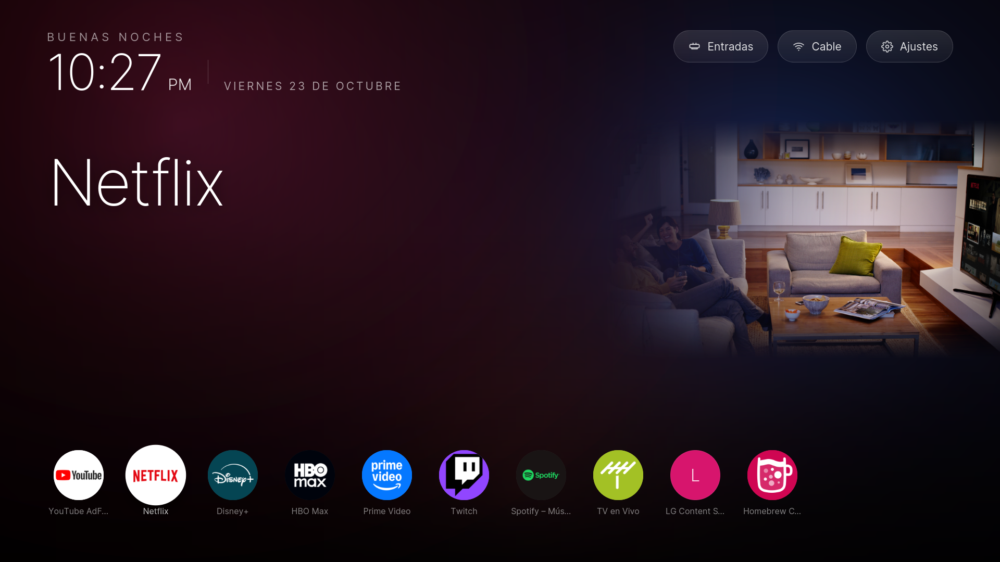
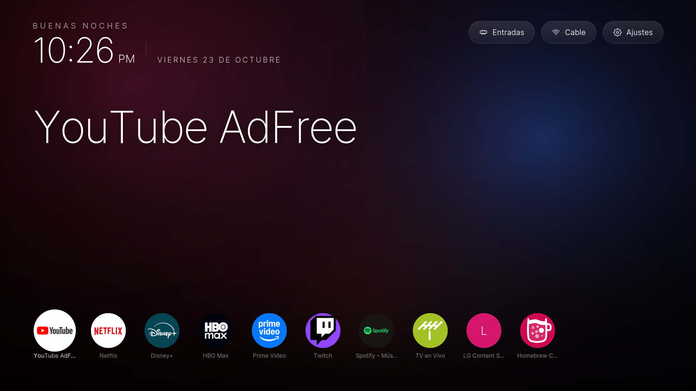
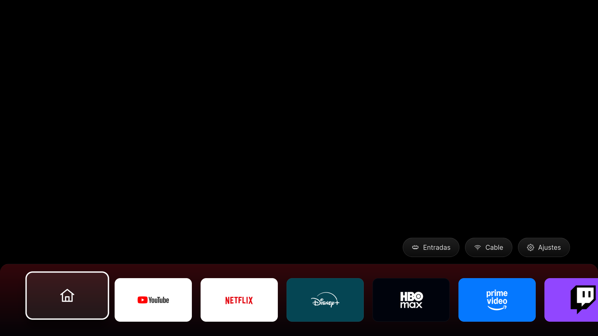

# Aurora

A home screen of your own for LG webOS 4 televisions (2018 models), built for
TVs that have got slow. It replaces LG's bar, draws in about two seconds, and
carries no ads, no recommendations and no sponsored rows.

It installs with **one command** and writes nothing to LG's partitions:
everything is our own files mounted on top. Uninstalling is just as easy.

> 🇪🇸 [Versión en español](README.es.md)



---

## Contents

- [What it is](#what-it-is)
- [The two variants](#the-two-variants)
- [Compatibility](#compatibility)
- [Versions tested](#versions-tested)
- [Requirements](#requirements)
- [Download](#download)
- [Install](#install)
- [Installer options](#installer-options)
- [Verify it worked](#verify-it-worked)
- [How to use it](#how-to-use-it)
- [Customise the row](#customise-the-row)
- [Uninstall](#uninstall)
- [What gets installed, and where](#what-gets-installed-and-where)
- [Measured performance](#measured-performance)
- [How it works inside](#how-it-works-inside)
- [Building from source](#building-from-source)
- [Troubleshooting](#troubleshooting)
- [Credits](#credits)

---

## What it is

A 2018 LG television with 1.5 GB of RAM spends a good part of it preloading
apps you may never open, and LG's home screen is slow to respond because it
fetches ads and recommendations over the network before it draws itself.

Aurora is an ordinary web app, packaged as a user app, that does three things:

1. **It draws before it asks for anything.** The background, the clock and the
   app row are there on the first frame. The icons and the data are already on
   disk — a boot script precomputes them — so painting the screen takes not a
   single network request.
2. **It has no ads.** There is nothing to fetch from any server.
3. **It reacts to what you focus.** The background glow takes the colour of the
   focused app and, where there is artwork, it blends in from the right.

Alongside Aurora go five boot scripts that are really half the improvement:
they free RAM, remap the remote's buttons, and make the TV open Aurora at
power-on.

---

## The two variants

Both get installed. They are the same app with a different presentation, and
they coexist without getting in each other's way.

| | `tv.aurora.home` | `tv.aurora.bar` |
|---|---|---|
| What it is | Full-screen home | Overlay bar at the bottom |
| When it appears | When you turn the TV on | When you press **HOME** |
| What it is for | Choosing what to watch when you are watching nothing | Switching apps without leaving what you are watching |
| First focus | The first app in the row | The house icon, which opens the full screen |

**Full screen** — the clock, the greeting and the app row:



**The bar** — it overlays whatever you are watching; shown here on black so the
icons read clearly:



---

## Compatibility

| | |
|---|---|
| **Works on** | LG webOS **4.x** (2018 televisions) with root |
| **Tested on** | LG 43UK6300PSB, firmware 05.50.70, webOS 4.4.3 |
| **Needs root** | Yes — [Homebrew Channel](https://github.com/webosbrew/webos-homebrew-channel) |
| **Not tested on** | webOS 3 (2017) and earlier, webOS 5+ (2020 and later) |

webOS 5 and later moved the key-filter files, so the HOME-button and hotkey
patches will not apply. The installer detects this and stops before touching
anything.

To find out whether **your** television can be rooted, check
[cani.rootmy.tv](https://cani.rootmy.tv) with your exact model and firmware.

---

## Versions tested

| Component | Version | Note |
|---|---|---|
| webOS TV Lite | 4.4.3 (`goldilocks-gorongosa`) | SDK 4.4.0 |
| LG firmware | 05.50.70 | model 43UK6300PSB |
| Linux kernel | 4.4.84 | `Rockhopper` 4.4.3-22 |
| Homebrew Channel | 0.7.3 | the root, and the bridge for running as root |
| dejavuln-autoroot | 0.0.10 | USB rooting, no developer mode needed |
| TV browser | Chrome 53 | this is what limits the code you can write |
| Aurora | 0.1.0 | this repository |

The browser is Chrome 53, from 2016. There is **no** CSS Grid, no `gap`, no
`backdrop-filter`, no `position: sticky`, no `aspect-ratio`, no optional
chaining (`?.`). There *is* flexbox, CSS variables, `filter: blur()`,
`object-fit`, `-webkit-mask-image`, `fetch`, `Promise`, `async` and template
literals. Keep that in mind if you touch the code: one stray `?.` gives you a
black screen and no error.

---

## Requirements

**On the television**

- webOS 4.x **rooted** with Homebrew Channel.
- **SSH enabled**: Homebrew Channel → *Settings* → **SSH Server** → on. Then
  reboot the TV once.
- TV and computer on the same network.

**On your computer** (macOS or Linux; on Windows, WSL)

- `ssh` and `scp` — already there.
- `python3` — only to build the packages. The installer does it for you if the
  `.ipk` files are missing. macOS ships it with the Command Line Tools.

Nothing else: no LG SDK, no `ares-cli`, no Node.

---

## Download

```bash
git clone https://github.com/josearevalo19977722-dev/lg_aurora.git
cd lg_aurora
```

Or grab the ZIP from *Code → Download ZIP* and unpack it.

You need the TV's **IP address**: *Settings → Network → Wi-Fi Connection →
Advanced*. If it changes, find it by LG's MAC prefix:

```bash
arp -a | grep -i a8:23:fe
```

---

## Install

One command. It takes about three minutes, most of it copying artwork.

```bash
./instalar.sh 192.168.1.50
```

Use your TV's IP. The installer narrates what it does:

```
1/6  Comprobaciones
  paquetes listos
  conexion SSH correcta
  televisor rooteado con Homebrew Channel
  webOS 4 confirmado

2/6  Instalando Aurora
  variantes instaladas: 2

3/6  Scripts de arranque
  10-liberar-ram
  20-teclas
  30-aurora-input
  35-aurora-datos
  45-aurora-arranque

4/6  Generando los parches en el televisor
  precarga: 9 apps desactivadas
  boton HOME -> tv.aurora.bar
  boton netflix -> youtube.leanback.v4
  boton amazon -> com.disney.disneyplus-prod

5/6  Precalculando datos, iconos e ilustraciones
  datos.js (172649 bytes) y 75 iconos
  arte ancho: 20 copiados (30368 KB)

6/6  Comprobacion
  RAM libre: 362 MB
```

It offers to reboot at the end. **You do need to reboot**: the key patches only
take effect from a boot, because the compositor reads those files when it
starts.

Running it again is safe: it detects the previous installation, unmounts it to
read LG's original files, and puts it back. Nothing gets duplicated.

---

## Installer options

Pass them as variables in front of the command:

```bash
BOTON_NETFLIX=youtube.leanback.v4 \
BOTON_AMAZON=com.disney.disneyplus-prod \
./instalar.sh 192.168.1.50
```

| Variable | What it does |
|---|---|
| `BOTON_NETFLIX=<appId>` | the remote's Netflix button opens this app |
| `BOTON_AMAZON=<appId>` | the remote's Amazon button opens this app |
| `SALTAR_RAM=1` | leave LG's app preloading alone |
| `SIN_REINICIO=1` | do not ask about rebooting at the end |
| `CLAVE=<path>` | a specific SSH key, if not the one in your agent |

To find an app's `appId`, list what the TV already has:

```bash
ssh root@<IP> 'ls /media/cryptofs/apps/usr/palm/applications /usr/palm/applications'
```

Real examples: `netflix`, `amazon`, `com.disney.disneyplus-prod`,
`com.wbd.stream` (HBO Max), `youtube.leanback.v4`,
`tv.twitch.tv.starshot.lg`, `spotify-beehive`, `com.webos.app.livetv`.

---

## Verify it worked

After rebooting:

```bash
# the five boot scripts, in place
ssh root@<IP> 'ls /var/lib/webosbrew/init.d/'

# the mounts: 5 preload configs and 2 key patches
ssh root@<IP> 'mount | grep -c "preloadmanager\|KeyFilters"'   # should print 7

# the compositor started AFTER the patches were mounted, or it never read
# them: this number must be greater than ~45
ssh root@<IP> 'expr $(awk "{print \$22}" /proc/$(pgrep -x surface-manager)/stat) / 100'

# free memory
ssh root@<IP> 'free -m | awk "/Mem:/{print \$7\" MB\"}"'
```

And each script's log, which says exactly what it did:

```bash
ssh root@<IP> 'tail -5 /var/lib/webosbrew/*.log'
```

---

## How to use it

| Remote button | What it does |
|---|---|
| **HOME** | opens Aurora's bar over whatever you are watching |
| **HOME** in the bar, on the house icon | opens the full screen |
| **BACK** | closes Aurora and returns to what was there |
| **Netflix** / **Amazon** | whatever app you set in the options |
| ◀ ▶ | move along the row |
| ▲ | go up to *Inputs*, *Cable* and *Settings* |
| **OK** | open |

*Inputs* opens the TV's HDMI and other input list; *Cable* returns to live TV;
*Settings* opens LG's settings.

At power-on, the TV goes straight into Aurora. If you would rather it did not,
you do not need to uninstall anything:

```bash
ssh root@<IP> 'touch /media/internal/aurora-no-arrancar'
```

Delete that file to turn it back on.

---

## Customise the row

Copy `aurora.ejemplo.json` to the TV as `aurora.json` and pick the order and
what you do not want to see:

```bash
scp aurora.ejemplo.json root@<IP>:/media/internal/aurora.json
```

```json
{
  "orden": [
    "youtube.leanback.v4",
    "netflix",
    "com.disney.disneyplus-prod",
    "com.webos.app.livetv"
  ],
  "ocultar": [
    "com.webos.app.browser"
  ]
}
```

Anything not listed in `orden` goes after it, alphabetically. Changes show up
next time you open Aurora.

---

## Uninstall

```bash
./desinstalar.sh 192.168.1.50
```

It removes both apps, the TV input, the five boot scripts, unmounts the patches
and deletes the logs. Then reboot:

```bash
ssh root@<IP> reboot
```

The TV ends up **exactly** as it was. Nothing was ever written to LG's
partitions, so there is nothing to restore: just our own files deleted and
mounts undone.

---

## What gets installed, and where

Everything lives in two places, both of them ours:

```
/media/developer/apps/usr/palm/applications/
├── tv.aurora.home/          the full screen
│   ├── index.html  app.css  app.js  modo.js
│   ├── datos.js             generated: the TV's own app list
│   ├── iconos/              generated: 75 icons copied from the system
│   ├── arte/                generated: 20 wide artwork images (~30 MB)
│   └── fonts/               Inter 200/300/400/600, local, no network
└── tv.aurora.bar/           the bar, same files

/var/lib/webosbrew/
├── init.d/
│   ├── 10-liberar-ram       turns off preloading, AirPlay and HomeKit
│   ├── 20-teclas            mounts the compositor patches
│   ├── 30-aurora-input      registers Aurora as a TV input
│   ├── 35-aurora-datos      precomputes datos.js, icons and artwork
│   └── 45-aurora-arranque   opens Aurora at power-on
├── preloadmanager-disabled.json   generated from the TV's own file
├── systemUi-patched.js            generated from the TV's own file
├── appLaunch-patched.js           generated from the TV's own file
└── *.log                          what each script did, with timestamps
```

The three `-patched` files are **not** in this repository: they are generated
on the television from its own files. That way the patch matches your firmware
and not somebody else's.

---

## Measured performance

Measured on the test television, not estimated.

| | Before | After |
|---|---|---|
| Free RAM | ~183 MB (with swap) | **362–379 MB** |
| Apps preloaded by LG | 9 | 0 |
| Ads on the home screen | yes | no |

**What Aurora itself costs** is about the same as any other launcher: **61 MB**
RSS, against 59–60 MB for [Hearth](https://github.com/webosbrew/hearth). The
RAM difference above does not come from Aurora; it comes from turning off LG's
preloading.

> A warning if you measure it yourself: comparing *free memory* before and
> after is useless, because it includes system caches. You have to look at the
> process RSS (`ps` on the TV). My first comparison done that way read 57 MB
> against 137 MB, and it was noise.

**Boot**, timed from power-on:

| Second | What happens |
|---|---|
| ~43 s | the earliest webOS will run `init.d` scripts |
| ~50 s | `20-teclas` restarts the compositor so it reads the patches |
| ~62 s | Aurora appears |

Sixty seconds is the floor with these patches in place: the compositor has to
restart to read the key files, and any app opened before that goes down with
it. That is why `45-aurora-arranque` waits for the compositor to be reborn
rather than waiting a fixed number of seconds.

---

## How it works inside

This is the part that takes the time to work out. If you are going to touch the
code, or adapt it to another television, start here.

### LG's partitions are never written to

`/etc` and `/usr` are read-only, and even if they were writable, a firmware
update would leave them half-patched. Everything is a **bind mount**
(`mount -o bind`) of our own file on top of LG's. Unmount, and the original is
right there, untouched. There are no backups to restore because nothing was
touched.

### Patches are generated on the TV, not shipped ready-made

Every firmware ships its own files. A patch built for another television mounts
just as happily and breaks things silently. So `instalar-en-tv.sh` runs **on
the television**, reads that television's files, and applies a `sed`.

It also checks the **line count** before and after: if the `sed` did not find
what it was looking for, or found too much, the count changes and it aborts.
`20-teclas` repeats the check at every boot, so if an LG update changes the
original file, the patch simply does not mount.

### A previous installation covers itself up

This was the hardest bug to see. On the second install, LG's original file is
already covered by our patch. Reading it gives you a patch built on a patch.

With the preload config it was worse: the redirection `sed original > patch`
truncates the output file **before** `sed` reads the input, and since the mount
makes the two the same inode, the original drops to zero bytes. The result was
an empty JSON mounted over `configd`'s configuration.

The fix is twofold: unmount everything before reading anything (`despegar`),
and always write to a temporary file that gets moved into place at the end.

### Preloading lives in a read-only config

`com.webos.service.preloadmanager.json` decides which apps are loaded into
memory at boot. It lives in `/etc/configd/layers/`, and there are **five**
copies: the base one plus one per screen profile (`hd1080-lite`,
`hd1080-normal`, `hd2160-lite`, `hd2160-normal`). The patch has to be mounted
over all five, or `configd` picks the one you missed.

### HomeKit comes back if you just stop it

`stop airplay-adaptor` works. For `homekit` it is not enough, because `ls-hubd`
starts it on demand: you have to kill it. And the boot keeps bringing things up
after second 43, so `10-liberar-ram` repeats the cleanup at 90 seconds.

### The remote's hotkeys are in a JavaScript file

The Netflix and Amazon buttons never touch the service bus: they are written
literally in `/usr/lib/qt5/qml/KeyFilters/appLaunch.js`, as
`appId = "netflix";`. Change that string and you change the button.

### The HOME button cannot be caught from an app

On webOS 4, LG's bar is not an application that comes to the foreground: it is
a compositor layer. `getForegroundAppInfo` never reports it, so an app cannot
know it opened, nor close it. You have to take the key at its source, in
`systemUi.js`, and you have to patch **both** calls:

- `global.goHome();` → `applicationManager.launch("tv.aurora.bar");`
- `global.prepareToGoHome();` → a comment

Patch only the first and LG's bar peeks out underneath for an instant on each
press. It is replaced with a comment, rather than with nothing, to keep the
line count the same so the check still passes.

### …and mounting the patches is not enough

`surface-manager` reads those files when it starts, at around second 2. The
`init.d` scripts do not run until second 43. So mounting does nothing until the
next boot — unless you restart the compositor, which is what `20-teclas` does,
and only if it mounted something new on that pass.

### Registering a TV input needs a flag nobody mentions

`luna://com.webos.service.eim/addDevice` returns `returnValue: true` and no
input appears, unless the app's `appinfo.json` declares `"supportGIP": true`.

### "Boot into my launcher" is really "resume the last input"

webOS has no startup-app setting: at power-on it returns to the input you were
on when you switched off. If you turned it off watching the PS5, you come back
to the PS5. Registering Aurora as an input makes it *be* an input, not the one
chosen. So `45-aurora-arranque` launches it by hand, after waiting for the
compositor to be reborn.

### `luna-send` fails silently without stdin

Inside a boot script there is no terminal. `luna-send` waits and returns
nothing. Every call carries `</dev/null`. And since it returns JSON across
several lines, you have to pipe it through `tr -d '\n'` before a `sed`, or the
log comes out mangled.

### The shell is busybox

`sleep 0.7` does not work: integers only. Nor does `timeout 45 cmd`: here it is
`timeout -t 45`. And be careful with `pgrep -f`, which can match your own SSH
session and kill it.

### Taking clean screenshots

The TV exposes the Chrome DevTools Protocol on port 9998:

```bash
ssh -N -L 19998:127.0.0.1:9998 root@<IP> &
curl -s http://127.0.0.1:19998/json      # get the page id
# then send Page.captureScreenshot over the WebSocket for that page
```

The screenshots in this repository come from there: real 1920×1080, no glare,
no moiré. Before reinstalling a package, close the app with `closeByAppId` or
you are left with ghost instances in the inspector's list.

### Injecting remote keys for testing

You write 16-byte events to `/dev/input/event1`:

```python
struct.pack("<llHHi", 0, 0, type, code, value)
```

Useful codes: ◀ 105, ▶ 106, ▲ 103, ▼ 108, **OK** 28. The **BACK** button is not
`KEY_BACK` (158): on this remote it is **412** (`KEY_PREVIOUS`). I lost a good
while convinced the handler was broken when what was broken was my test.

---

## Building from source

The `.ipk` files are not in the repository; they are generated. The installer
does it for you, but you can do it by hand:

```bash
python3 tools/build-ipk.py home   # -> tv.aurora.home_0.1.0_all.ipk
python3 tools/build-ipk.py bar    # -> tv.aurora.bar_0.1.0_all.ipk
```

The packer is written in pure Python on purpose. An `.ipk` is an `ar` archive
holding `debian-binary`, `control.tar.gz` and `data.tar.gz`, and macOS's `ar`
and `tar` insert `AppleDouble` and `PaxHeader` entries that the television
rejects without explaining why.

To install a single package by hand:

```bash
scp tv.aurora.home_0.1.0_all.ipk root@<IP>:/tmp/
ssh root@<IP> 'luna-send -n 5 -f luna://com.webos.appInstallService/dev/install \
  "{\"id\":\"com.ares.defaultName\",\"ipkUrl\":\"/tmp/tv.aurora.home_0.1.0_all.ipk\",\"subscribe\":true}"'
```

To see the app's console while developing, open `http://127.0.0.1:19998` in
your browser with the SSH tunnel above up.

---

## Troubleshooting

**SSH will not connect.** Check that *SSH Server* is on in Homebrew Channel and
that you rebooted the TV afterwards. If the IP changed, find it with
`arp -a | grep -i a8:23:fe`.

**It says the TV is not rooted.** The installer looks for
`/var/lib/webosbrew`. If it is not there, Homebrew Channel is not installed.
Check [cani.rootmy.tv](https://cani.rootmy.tv) with your model and firmware.

**It says this is not webOS 4.** It looks for
`/usr/lib/qt5/qml/KeyFilters/systemUi.js`. On webOS 5 and later it is not
there, and the key patches cannot be applied.

**HOME still opens LG's bar.** Almost always it means you have not rebooted.
Check that the compositor started after the patch was mounted: the number in
[Verify it worked](#verify-it-worked) has to be greater than ~45.

**At power-on it goes to HDMI and not to Aurora.** That is normal for the first
60 seconds: `45-aurora-arranque` waits for the compositor to be reborn before
launching it. Look at `tail /var/lib/webosbrew/aurora-arranque.log`, which says
at what second it launched and where it came from.

**An app has no background artwork.** Not all of them ship it. Aurora checks
the image's real size before showing it, so a missing one gives you no black
rectangle: you just get the colour glow.

**Icons are missing, or the row is empty.** Run the data script again:

```bash
ssh root@<IP> 'sh /var/lib/webosbrew/init.d/35-aurora-datos; tail -3 /var/lib/webosbrew/aurora-datos.log'
```

**I want out, now.** `./desinstalar.sh <IP>` and reboot.

---

## Credits

- [webosbrew](https://github.com/webosbrew) — Homebrew Channel and the bridge
  that lets an app run commands as root.
- [dejavuln-autoroot](https://github.com/throwaway96/dejavuln-autoroot) — the
  USB root that needs no developer mode.
- [Hearth](https://github.com/webosbrew/hearth) — the launcher I used as a
  reference to check whether Aurora was overspending on memory.
- [RootMy.TV](https://rootmy.tv) and [cani.rootmy.tv](https://cani.rootmy.tv).
- [Inter](https://github.com/rsms/inter) — the typeface, by Rasmus Andersson,
  under the SIL Open Font License 1.1 ([full text](src/fonts/LICENSE.txt)
  ships alongside the files).

The system tweaks on their own, without the launcher, are at
[lg-webos4-tweaks](https://github.com/josearevalo19977722-dev/lg-webos4-tweaks).

This is not affiliated with LG in any way. Use at your own risk: it does not
touch LG's partitions, but rooting a television is your call.

## License

MIT — see [LICENSE](LICENSE). The Inter typeface is under its own licence,
SIL OFL 1.1, in [src/fonts/LICENSE.txt](src/fonts/LICENSE.txt).
